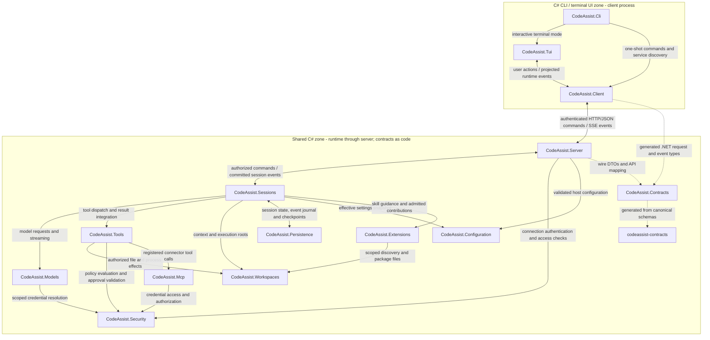
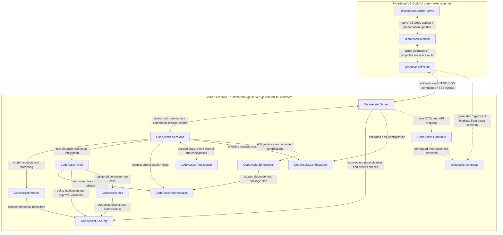

# CodeAssist Architecture

CodeAssist has two interfaces: a C# command-line and terminal application, and a native TypeScript VS Code extension. The target architecture gives both clients access to one C# runtime that owns conversations, model calls, tools and permissions.

This guide explains that target design and its package boundaries. The [current implementation](#current-implementation) section describes what exists today and where it differs. For a capability-by-capability delivery summary, see [feature status](/guide/features/).

## Architecture overview

The runtime runs as a service, and both clients use the same versioned API. HTTP requests carry commands such as submitting a turn, answering an approval or cancelling an operation. Server-sent events (SSE) carry progress and results back to the clients.

Each client handles presentation and user interaction. The C# runtime handles provider access, tool execution, authorization, session state and persistence. The TypeScript extension reuses this behavior through the API; it does not load C# assemblies or implement its own agent loop. The documentation website is independent of these two product clients.

The service is a modular monolith: its packages run together in one process and communicate through .NET interfaces. Start with one service instance per execution scope, such as a trusted workspace/profile. Compatible clients in the same scope can attach to that instance; a different scope can use another instance of the same runtime.

### A request through the system

1. A user submits a prompt from the terminal or VS Code. The client sends an authenticated command to `CodeAssist.Server`.
2. The server checks access and passes the command to `CodeAssist.Sessions`, which serializes work for that session.
3. The session runtime calls a model through `CodeAssist.Models` and dispatches tools through `CodeAssist.Tools`. Tool effects require policy checks and, where needed, user approval.
4. The runtime persists replayable events before publishing them. Each attached client receives those events over SSE and updates its view.
5. Approval answers and cancellation requests return through the command API. Disconnecting a client does not transfer session ownership or implicitly cancel work.

### Why the CLI also uses the API

Although the CLI could call C# runtime assemblies directly, using the same API as the editor keeps session ownership, approvals, cancellation and recovery in one place. A separate in-process CLI engine would create another execution path to maintain.

The CLI can launch the service executable and then connect to it. A future embedding SDK could compose the runtime modules in-process for other hosts, but neither product client needs that SDK.

## Communication and contracts

| Boundary | Recommended mechanism | What it shares |
| --- | --- | --- |
| C# CLI to C# service | Authenticated HTTP/JSON commands and SSE event subscription | Runtime behavior through a server, not direct engine calls. |
| TypeScript extension host to C# service | The same HTTP/JSON API and SSE event envelope | The same runtime behavior without a TypeScript engine. |
| Native VS Code views to extension controller | VS Code APIs and in-process TypeScript calls | Presentation state and user actions. No separate browser server is required. |
| Optional rich webview to extension host | Narrow, validated `postMessage` messages | UI actions and sanitized projections only; never credentials or direct runtime access. |
| Modules inside the C# service | Dependency injection and .NET interfaces | Domain behavior, adapters and execution services as code. |
| Contract source to both client libraries | Build-time generation plus conformance tests | Wire DTOs, operation definitions and event payload types, not domain objects. |

The `codeassist-contracts` package is the source of truth for the protocol. It contains a checked-in OpenAPI document and JSON schemas for requests, responses and event payloads. These schemas generate C# data transfer objects (DTOs) and request/type bindings for both client libraries. Generated server documentation must agree with this source rather than define another independently edited contract.

Each client also needs a small maintained streaming layer for authentication, SSE parsing, event cursors, reconnect and cancellation. An OpenAPI generator may generate request types without implementing resumable streaming correctly. Pin a toolchain that supports the chosen OpenAPI/schema version and verify its event handling.

### Package naming

- C# projects, assemblies, namespaces and NuGet packages use dotted PascalCase: `CodeAssist.Tui`, `CodeAssist.Client`, `CodeAssist.Contracts` and `CodeAssist.Server`.
- TypeScript/npm packages use lowercase scoped names, with kebab-case for multiword names: `@codeassist/client`, `@codeassist/editor` and `@codeassist/editor-views`.
- The language-neutral schema package stays `codeassist-contracts`. It owns the canonical schemas; `CodeAssist.Contracts` contains generated C# types, not a second schema source.

These are the project and package names. Each named C# module has its own assembly; the three TypeScript packages have separate workspace boundaries. They do not need independent releases. `CodeAssist.Testing` is an additional test-support assembly, never a shipped runtime dependency. These boundaries are implemented; the [current implementation](#current-implementation) section distinguishes them from pending runtime behavior.

### Feature ownership and internal interfaces

There is no `CodeAssist.Core` project in this design. Shared code belongs to the feature that owns its behavior rather than a catch-all foundation or infrastructure assembly. A folder organizes a feature's implementation; a project establishes a dependency boundary. Do not duplicate a feature under both a shared project and its own project.

| Owner | Contents | Excludes |
| --- | --- | --- |
| `CodeAssist.Sessions` | Session state, turn lifecycle, history and agent orchestration | Built-in tool implementations, connector SDKs and package installation |
| `CodeAssist.Tools` | Tool descriptors, execution interfaces, argument validation, effect plans, dispatch and built-in tools | Connector protocol implementation and skill/plugin distribution |
| `CodeAssist.Extensions` | `Skills/` for discovery, parsing, rendering and resources; `Plugins/` for packages, registries, activation and contributions | A second tool dispatcher, model loop or credential store |
| `CodeAssist.Mcp` | Connector SDK adapters, connection lifecycle, protocol negotiation and OAuth coordination | General authorization policy and persistent credential protection |
| Infrastructure projects | Workspace effects, persistence, security and configuration in their respective projects | An undifferentiated shared infrastructure folder |

Skills and plugins start as folders within `CodeAssist.Extensions`, not separate projects. They share guidance and contribution-loading behavior. Split them only when independent reuse, ownership or dependency isolation requires it. MCP has a separate project because its protocol dependencies, connection lifetime and authentication flow differ from local tool execution and extension loading.

`CodeAssist.Contracts` contains only the client/server wire boundary: generated request, response and event DTOs, protocol envelopes and serialization metadata. Internal interfaces such as tool execution, skill discovery, authorization and storage ports stay with their owning features. They are not added to the wire schema merely because another runtime module consumes them. The server maps domain objects to wire DTOs at the API boundary.

Cross-feature integration uses narrow interfaces and server composition adapters rather than mutual project references. Keep interfaces next to their owning behavior; do not introduce a shared abstractions project preemptively. If a concrete dependency cycle requires an extraction, identify the specific types and their owner first. Neither infrastructure adapters nor clients should depend on framework-backed session orchestration simply to obtain a foundational type.

### How to read the diagrams

- The upper zone contains the client interface and its transport adapter. These packages run with the client.
- The lower zone contains the shared C# runtime and build-time contract artifacts. Schema packages do not execute in the service.
- Solid arrows show calls or runtime traffic. Two-way arrows include requests and returned results/events. Dashed arrows show code references or generation dependencies, not network hops.
- The shared boxes in both diagrams represent the same implementation, not separate CLI and editor runtimes.

## CLI and terminal interface

`CodeAssist.Cli` handles command parsing and startup. Interactive mode uses `CodeAssist.Tui` for terminal presentation; both interactive and one-shot commands use `CodeAssist.Client` for transport and view updates.

The CLI imports the .NET client and generated contracts as code, but reaches the runtime through HTTP/JSON and SSE. It does not reference session, provider or tool implementation assemblies. `CodeAssist.Server` hosts those modules, with `CodeAssist.Sessions` coordinating conversation execution.

Terminal actions become API commands. The server authorizes them and dispatches them to the session owner, which publishes ordered events. The client uses those events to build the transcript, progress indicators and approval prompts. Approval answers and cancellation go back through the API rather than changing runtime state locally.

### CLI package responsibilities

| Package / module | Zone and language | Responsibility and relationship |
| --- | --- | --- |
| `CodeAssist.Cli` | UI / C# | Parses commands, selects workspace/profile, discovers or launches a compatible service and chooses interactive or one-shot presentation. Imports the .NET client, not the engine. |
| `CodeAssist.Tui` | UI / C# | Renders transcripts, diffs, progress and approval prompts. Owns drafts, focus and scroll, not authoritative session/tool state. Calls the client for user commands. |
| `CodeAssist.Client` | Client adapter / C# | Provides typed operations, authenticated HTTP, SSE parsing, event cursor management and reconnect. Executes in the CLI process; contains no model/tool execution. |
| `CodeAssist.Server` | Shared host / C# | ASP.NET Core executable and composition root. Owns API mapping, connection authentication, version/capability negotiation, subscriptions and runtime lifecycle. Delegates application behavior to sessions. |
| `CodeAssist.Sessions` | Shared application runtime / C# | Serializes commands per session; owns turn lifecycle, history, agent orchestration, approval waits, child-session coordination and event ordering. Uses an established .NET agent framework for model/tool iteration rather than creating a second provider stack. |
| `CodeAssist.Models` | Shared adapter / C# | Adapts provider SDKs through `Microsoft.Extensions.AI` abstractions. Owns model capabilities, streaming normalization, usage reporting and provider failure handling, not UI state or session persistence. |
| `CodeAssist.Tools` | Shared application module / C# | Owns tool contracts, registration, argument validation, effect plans, dispatch and built-in tools. Invokes admitted connector tools and extension-backed capabilities through composed interfaces; consults security before effects. |
| `CodeAssist.Extensions` | Shared feature module / C# | Owns skill discovery, parsing, rendering and resources under `Skills/`, and plugin packages, registries, activation and contributions under `Plugins/`. Supplies admitted guidance and contributions without owning session execution. |
| `CodeAssist.Mcp` | Shared integration module / C# | Owns connector SDK adapters, protocol negotiation, connections, resources, prompts and OAuth coordination. Exposes admitted connector capabilities through explicit interfaces; delegates policy and credential protection to security. |
| `CodeAssist.Workspaces` | Shared infrastructure / C# | Owns workspace identity, scoped paths, file/process/Git operations, context reads and watcher adapters. Executes effects on the service's execution machine, not automatically on the UI machine. |
| `CodeAssist.Persistence` | Shared infrastructure / C# | Stores sessions, ordered events, approvals, tool-operation records, checkpoints and content blobs. Exposes transactional repositories; owns migrations, retention and recovery reads. |
| `CodeAssist.Security` | Shared policy and infrastructure / C# | Owns authorization, approval grants, workspace restrictions and credential access. Binds grants to exact actions and session scope; UI confirmation alone never bypasses policy. |
| `CodeAssist.Configuration` | Shared configuration / C# | Resolves validated defaults, files, environment and managed policy into scoped snapshots. Keeps secrets out of public settings; JSON settings have equivalent `__`-nested environment paths. |
| `CodeAssist.Contracts` | Shared contract assembly / C# | Generated DTOs/envelopes and serialization metadata only. Contains no domain services, persistence entities, provider SDK types or tool implementations. Used by service and .NET client. |
| `codeassist-contracts` | Shared build-time artifact / language-neutral | Canonical OpenAPI and JSON schemas for operations, errors, snapshots and events. Drives generation and compatibility checks; is neither a server nor an executable engine. |

The CLI distribution may bundle `CodeAssist.Server` and launch it as a child or detached local process. Bundling changes installation and startup, not the API boundary or ownership of execution.

## VS Code extension

`@codeassist/editor-views` presents native chat and views. `@codeassist/editor` handles extension lifecycle, workspace trust and user actions. Both use `@codeassist/client`, a thin TypeScript transport library running in the extension host, to reach the same C# service as the CLI.

The extension imports generated TypeScript contracts and client code, not `CodeAssist.Contracts` or any other .NET assembly. Both languages' types come from the same schemas. Sessions, providers, permissions, tools and persistence stay in the C# runtime.

Native UI actions pass through the extension controller, which checks workspace trust and calls the client. Runtime events update the native views. If a rich webview is needed later, it communicates only with the extension host through a validated message bridge. Service tokens and provider secrets never enter the webview.

A webview is optional and does not require another application server.

### VS Code package responsibilities

| Package / module | Zone and language | Responsibility and relationship |
| --- | --- | --- |
| `@codeassist/editor-views` | UI module / TypeScript | Adapts session projections to native chat, tree views, editors and diff presentation. Owns drafts/selections/view state. An optional webview uses a narrow host bridge, not direct service access. |
| `@codeassist/editor` | Extension host / TypeScript | Registers commands/views, checks workspace trust, manages service connections and forwards intentional user context. Owns optional editor capabilities, not the shared agent loop. |
| `@codeassist/client` | Client library / TypeScript | Contains generated wire bindings and a small HTTP/SSE layer. Authenticates, tracks event cursors, reconnects and exposes typed operations. Runs in the extension host; has no JavaScript provider/tool runtime. |
| `CodeAssist.Server` | Shared host / C# | Exposes exactly the same API as for the CLI. Maintains client/session access boundaries and turns transport input into application commands. No editor-specific engine fork. |
| `CodeAssist.Sessions` | Shared application runtime / C# | Owns sessions, turn serialization, history and agent orchestration. Accepts authorized actions from either client and produces one ordered event stream per session. |
| `CodeAssist.Models` | Shared adapter / C# | Performs all provider/model interaction through the .NET abstraction and provider adapters. Provider credentials remain on the execution host, not in TypeScript bundles. |
| `CodeAssist.Tools` | Shared application module / C# | Owns tool admission, schemas, dispatch and results. Calls explicitly registered editor capabilities only when a client/session binding and policy permit them. |
| `CodeAssist.Extensions` | Shared feature module / C# | Supplies the same admitted skills and plugin contributions to both clients. Discovery, rendering, package validation and activation stay in C#, not the extension host. |
| `CodeAssist.Mcp` | Shared integration module / C# | Manages runtime-owned connector connections, prompts, resources and OAuth coordination. The editor displays controls and results without implementing another protocol client or credential cache. |
| `CodeAssist.Workspaces` | Shared infrastructure / C# | Performs authorized workspace effects at the selected execution host. Receives explicit unsaved-buffer snapshots when needed; does not silently scrape editor documents. |
| `CodeAssist.Persistence` | Shared infrastructure / C# | Persists the same session/event/checkpoint records used by CLI attachments, enabling consistent multi-client views and bounded replay. |
| `CodeAssist.Security` | Shared policy and infrastructure / C# | Enforces session/workspace/tool permissions and validates pending approvals regardless of which client renders the prompt. Owns credential access and client capability grants. |
| `CodeAssist.Configuration` | Shared configuration / C# | Owns runtime settings, provider/tool configuration and managed policy. The extension stores only client presentation/connection settings; runtime mutations go through authorized service operations. |
| `CodeAssist.Contracts` | Service-side contract assembly / C# | Maps API/event payloads inside the C# service. The TypeScript client does not load this assembly; its equivalent types are generated independently from the canonical schemas. |
| `codeassist-contracts` | Shared build-time artifact / language-neutral | Generates the editor client's request/event types from the same protocol source as the .NET client. Compatibility is determined by the protocol, not matching implementation languages. |

In the target design, the editor launches the .NET service directly and uses its API. It does not parse conversational CLI output. Both clients can distribute the same service executable without depending on each other's UI or command parser.

## Sessions and reliability

### Commands and events

HTTP/JSON commands create or attach to sessions, submit turns, answer approvals and cancel operations. A long-running command returns an accepted operation ID; the client then observes progress and results through authenticated SSE. Final outcomes remain queryable after reconnect, so an open prompt request is not the only record of a run.

Each event carries `protocolVersion`, `sessionId`, `sequence`, `eventId`, `kind`, `operationId`, `timestamp` and a typed `payload`. A cursor identifies a position in one session's event stream. The connection handshake also identifies the service instance, allowing clients to distinguish a restarted service from a temporary connection loss.

The runtime persists replayable events before publishing them and batches frequent model deltas before writing them to the journal. Transport heartbeats remain ephemeral. Clients rebuild their views from snapshots and events; rendered text is not the authoritative session record.

| Concern | Required behavior |
| --- | --- |
| Session authority | One active session owner serializes mutating commands. Turns queue or reject with an explicit conflict; concurrent UI attachments do not create concurrent owners. |
| Multi-client access | Both clients may observe an authorized session. Access is explicitly granted; matching workspace paths alone must not grant access to another process/client. |
| Retry | Mutating commands carry scoped idempotency keys and payload hashes. A durable command record lets retry return the existing operation; a changed payload with the same key is rejected. |
| Replay | Reconnect with the last acknowledged sequence. Deduplicate events; if retention has expired, fetch a snapshot with its exact cursor and continue from that cursor without a gap. |
| Slow consumers | Bound per-client buffers. Disconnect lagging readers with a recoverable cursor rather than growing memory or blocking execution indefinitely. |
| Cancellation | Explicit, authorized, operation-scoped command. Closing SSE or detaching a UI does not implicitly cancel a run. Cancellation acknowledgments and final outcomes are distinct. |
| Approvals | Persist a pending request bound to session, operation, tool arguments/effect and expiry. Validate answers atomically; duplicate/stale answers cannot authorize another action. |
| Crash recovery | Restore recorded state, mark uncertain in-flight effects and reconcile before continuing. Never blindly replay a shell command or external mutation after a crash. Idempotent API acceptance does not imply exactly-once external effects. |
| Durability | Use transactional storage, initially SQLite plus a bounded blob store. Coordinate session state, command records and replayable events; define migrations, retention and backup behavior before promising durable resume. |

A mailbox inside the service serializes commands for each session; this does not require a distributed actor platform. Storage locks or leases must separately prevent two service processes from becoming owners of the same scope. An in-process mailbox cannot provide that exclusion by itself.

### Editor-owned capabilities

File, process and tool execution stays in the C# service by default. Some operations need the editor, such as reading an explicitly supplied unsaved buffer or displaying an interactive diff. Expose these as narrow client capabilities.

Register each capability with an authenticated client and session, its supported operations and a way to revoke access. The runtime sends a request over that client's event channel; the client answers through an HTTP operation carrying the request ID. The runtime checks scope and policy again before using the response.

Payloads and timeouts are bounded. A disconnect fails or suspends the capability rather than granting permission or routing work to an unrelated client. The TypeScript handler is a host adapter, not an unrestricted tool executor. Any client-side effect follows the same operation tracking and uncertain-outcome rules as a server effect.

## Startup, security and deployment

### Local service lifecycle

1. The client checks workspace trust, resolves execution scope and reads an owner-restricted discovery record containing endpoint, process-instance identity and protocol information. Tokens are obtained through a protected channel, not public discovery metadata.
2. Authenticate and negotiate protocol major/minor, capabilities and contract identity. Reject incompatible major versions with an actionable diagnostic; negotiate optional features rather than requiring identical application builds.
3. If no compatible service exists, an authorized client acquires a startup lock and launches the service executable directly. The service binds an ephemeral loopback port and publishes readiness only after authentication and storage initialization are complete.
4. Transfer a fresh bootstrap credential using an inherited pipe/handle or equivalent protected mechanism. Do not put credentials in command-line arguments, logs, workspace files or webviews. Other authorized clients obtain access through an owner-scoped credential broker/store, not by reading world-visible endpoint files.
5. Connect, then create or explicitly attach to a session. Process ownership and session ownership are separate: an extension shutdown detaches its connections, not another client's sessions or a reused service.

Local endpoints bind to loopback by default and require authentication scoped to the installation and execution scope. Validate allowed hosts and origins, reject unapproved browser access and avoid wildcard CORS. A loopback address does not authenticate a caller. Client tokens stay in the extension host or CLI process; provider credentials stay in an OS credential store on the service host.

The service validates workspace roots, symlinks, arguments, network destinations and policy where effects occur. These checks and child-process execution do not provide an OS sandbox. Strong isolation requires a separate worker or container policy with explicit resource and filesystem boundaries.

### Remote workspaces

For SSH, container and similar remote workspaces, the extension connects to a C# service on the workspace host and executes tools there. The desktop UI and execution host may be different machines. Transfer selected context explicitly, resolve paths on the execution host and keep provider credentials there unless credential delegation is deliberately configured.

A network-accessible service needs encrypted, authenticated transport and an explicit access policy. Exposing the default loopback listener or reusing its bootstrap token is not a public-server authentication design.

### Packaging

Distribute a versioned service executable for each supported OS/architecture alongside the CLI and extension runtime assets. The executable may be self-contained. Stable protocol contracts and declared compatibility ranges allow the clients to release independently.

An update must not replace a service process while it has active operations. Drain its work safely or keep the compatible instance running until its work finishes.

## Dependency rules and verification

- CLI and terminal modules may reference the .NET client and wire contracts, never service/session/model/tool implementations.
- The editor may reference the TypeScript client and UI APIs, never a JavaScript provider runtime or .NET assembly-loading bridge.
- `CodeAssist.Server` is the composition root. Sessions depend on abstractions for models, tools, workspace, storage, policy and configuration; concrete adapters do not depend on either UI.
- Feature projects own their internal interfaces and implementation. There is no catch-all `CodeAssist.Core`, no parallel copies of feature types, and no separate Skills or Plugins project without a demonstrated boundary need.
- `CodeAssist.Extensions` owns skills and plugin loading; `CodeAssist.Mcp` owns connector protocol and lifecycle. Tools consumes composed capabilities without absorbing their infrastructure. Project references must remain acyclic; runtime call arrows in the diagrams do not prescribe assembly-reference direction.
- Contract packages contain only wire schemas/types. Storage entities, framework agent types and credentials never become wire DTOs by accident.
- The service authorizes every command and effect. UI restrictions improve ergonomics but do not replace runtime enforcement.
- OpenAPI generation, event-envelope compatibility and generated-client drift checks run in CI with pinned tool versions.
- Shared client-conformance scenarios cover both languages: create/send/observe, replay, duplicate command, concurrent approval answer, stale cursor, cancellation, incompatible version and unauthorized session access.
- End-to-end acceptance attaches CLI and editor to one session, submits a turn from one, observes it in both, disconnects/reconnects either client and verifies that effects are not duplicated.

These rules keep execution in one C# implementation, with one protocol source, two client libraries and two independent interfaces. HTTP/SSE connects the languages; .NET interfaces separate modules inside the runtime.

## Current implementation

The repository uses the project and package boundaries above, including separate `CodeAssist.Extensions` and `CodeAssist.Mcp` assemblies. Both product clients reach the standalone service rather than composing an in-process engine. Committed conversation recovery and bounded checkpoints are implemented; durable coding execution and several interactive workflows remain pending. Structural alignment does not imply all reliability guarantees above are delivered.

The .NET 10 source tree contains 14 product projects plus `CodeAssist.Testing`, including management commands, tool components, official SDK providers, a shared catalog and an authenticated framework-backed HTTP service. The editor text client and streamed CLI `run`/line-oriented `chat` are delivered. Durable coding orchestration and a full TUI remain target work.

### Project boundaries

| Project | Responsibility | Dependencies |
| --- | --- | --- |
| CodeAssist.Contracts | Generated session DTOs, wire records, shared wire enums and protocol descriptors | No project dependencies |
| CodeAssist.Configuration | Layered settings, trust, validation, provenance and JSONC editing | Contracts |
| CodeAssist.Sessions | Framework-backed sessions, bounded turn state and journal-backed session services | Configuration, Contracts, Tools, Models, Extensions, Persistence |
| CodeAssist.Models | Model catalog interface, official SDK adapters, shared catalog and model discovery tool | Tools, Workspaces |
| CodeAssist.Tools | Tool contracts, argument validation, effect plans, dispatch, built-ins and tool-facing workspace adapters | Contracts, Persistence, Workspaces |
| CodeAssist.Extensions | Skill contracts, discovery, parsing, rendering and tool adapters; plugin contracts, packages and registries | Tools, Workspaces, Persistence |
| CodeAssist.Mcp | Connector contracts, SDK adapters, lifecycle, OAuth coordination and connector tool adapters | Tools, Workspaces |
| CodeAssist.Workspaces | Path, filesystem, glob, process and network primitives | No project dependencies |
| CodeAssist.Persistence | Journal records/JSONL components and exclusive bounded checksummed conversation checkpoints | Contracts, Workspaces |
| CodeAssist.Security | Authorization, HTTP access checks and protected credential cache | Tools, Persistence |
| CodeAssist.Server | Standalone executable, composition, management APIs and telemetry | Runtime modules and contracts, never clients |
| CodeAssist.Client | Authenticated bounded HTTP transport and owned-service launch | Contracts only |
| CodeAssist.Tui | Terminal presentation and transcript boundary | Client, Configuration, Contracts |
| CodeAssist.Cli | Spectre command tree, local settings and transport-backed management | Tui, Client, Configuration, Contracts |
| CodeAssist.Testing | Shared isolated fixtures and live-test support | Never referenced by shipped projects |

Architecture tests enforce the declared project set, allowed references, acyclic graph, feature ownership of internal contracts and exclusion of test tooling from shipped projects. The CLI has no runtime assembly reference to the server, sessions, providers or tools. A distribution-only server project edge bundles service assets without exposing its assembly to CLI code. The CLI project remains the .NET tool packaging entry point.

### Feature ownership

Internal interfaces live with their features: tool execution in `CodeAssist.Tools`, skills and plugin content in `CodeAssist.Extensions`, connector connections and prompts in `CodeAssist.Mcp`, the model catalog in `CodeAssist.Models`, and journal storage in `CodeAssist.Persistence`. Journal facts and intents belong to Persistence, not the wire contract assembly. Their existing serialized field names and discriminators are unchanged.

The server owns the cross-feature `ToolPorts` aggregate and built-in catalog composition. Connector and skill adapters implement tool interfaces without forcing Tools to reference their assemblies. Security supplies authorization through the tool authorization interface; Tools does not reference Security. Infrastructure no longer references Sessions merely to consume shared types, and no Core or catch-all abstractions project is introduced.

This organization changes code ownership and dependency isolation. It does not by itself deliver durable sessions, replay, approvals or additional interactive workflows.

### Composition and lifetime

The entry point builds one Generic Host and runs the Spectre command tree against its service provider. Command groups cover settings, providers/catalog, connector definitions, tools/catalog and diagnostics. Settings are loaded with trust, provenance and validation; environment and flag overlays are not written back.

The standalone `CodeAssist.Server` executable owns composition, model-catalog services, provider resolution, connectors, management handlers and runtime telemetry. CLI provider/tool/plugin/skill/runtime-connector commands use `CodeAssist.Client` over authenticated HTTP. Local configuration commands remain local. The explicit `serve` command launches the bundled service and forwards its bound URL; it does not host ASP.NET Core inside the CLI. Scope discovery, pairing and shared-process reuse remain pending.

The HTTP runtime uses Microsoft Agent Framework `ChatClientAgent` over Microsoft.Extensions.AI `IChatClient` implementations supplied by server composition. A bounded session lease prevents concurrent turns; a detached framework-state snapshot becomes committed history only after successful completion. Catalog endpoints and model execution use the same provider metadata source. The server composition root wires concrete adapters behind session ports. See the [server guide](/guide/server/).

`codeassist-contracts/openapi.json` is checked in with a pinned generator. It generates TypeScript operation/schema types and C# session/health DTOs; other wire records and maintained request wrappers are not yet fully generated. Constructor-order metadata preserves C# caller compatibility without redefining wire shapes. CI checks generated output and compares all published API paths against the canonical document. Separate durable-event schemas and resumable streaming bindings remain pending.

### Providers and tools

Provider adapters return `IChatClient` implementations backed by vendor SDKs. Explicit routing wins over adapter/catalog inference; model metadata constrains known capabilities and output caps. Missing capability data remains unknown, allowing custom models. Native cloud setup variables are resolved separately from API keys. Vault/OAuth and engine-owned retry/limiter/telemetry orchestration remain pending.

The catalog reads models.dev over HTTPS with bounded responses, ETag revalidation and a last-good disk cache. Settings override cached metadata. There is no bundled snapshot. Refresh and query operations are available through the transport-backed CLI; daily scheduling remains pending.

Tool contracts, effects, plans, validation and pure text algorithms live in `CodeAssist.Tools`. `CodeAssist.Workspaces` provides filesystem/path/glob/network/process support. `CodeAssist.Tools` implements read/find/write/edit/transactional structured patch, foreground process execution and bounded web fetch; interaction/delegation/search shims require supplied ports. Skill and connector tool adapters live with their respective features and are composed by the server. Catalog commands inspect these definitions rather than run an agent loop.

### Runtime delivery gaps

Durable coding execution, event replay, root tool-policy enforcement, approval execution and projections remain target work. The proposed replay contract requires persisted, batched deltas; the existing transient stream does not provide that guarantee. Conversation snapshots do not supply durable in-flight execution.

The HTTP service supports committed conversation recovery, metadata/archive, retained history rewind, reported token/turn admission limits, JSON/SSE and cancellation. It does not execute coding tools or approvals. Spectre commands use Generic Host DI, a provided input reader, shared `CodeAssist.Tui` transcript/command/data views and the .NET transport. Native conversation operations remain separate from namespaced configured/skill/plugin prompt expansion; text never grants permissions. Owned services stop on command exit; external services are only disconnected. Full-screen TUI and automatic service reuse remain pending. Connector configuration stays local; runtime connection and prompt commands delegate to server-owned handlers.

### Native editor boundary

`vscode-extension/` owns the extension's npm workspace, lockfile, shared TypeScript configuration and packaging shell. Its internal packages live under `vscode-extension/packages/`: `@codeassist/editor` owns the native controller, `@codeassist/editor-views` owns presentation helpers, and `@codeassist/client` owns transport and process launch. Shared `codeassist-contracts/` stays at the repository root with its own generator dependencies and lockfile; the client links its generated wire types. Stable VS Code APIs provide native `@codeassist` chat, command-palette fallback, explicit selection capture, session/history/model controls and connection status. The client validates bounded HTTP/SSE responses and server protocol; model output is untrusted markdown with no enabled command links or HTML.

Managed mode starts a private, owned `CodeAssist.Server` child directly on an ephemeral loopback port using an argument array and generated environment token. Startup reads one versioned JSON readiness record and verifies authenticated health, never conversational CLI output. External mode uses a user-configured loopback origin and SecretStorage token, without process ownership. Workspace trust is required, repository launch overrides are ignored, and disconnect/unload stops only an owned child. Native conversation metadata is tied to the connection lifetime; reconnect never silently resends a prompt or claims durable resume. Protected bootstrap pipes and cross-client service sharing are not yet implemented.

The extension runs in the workspace host, including SSH/WSL/container contexts. Native file/diff review, dirty-buffer conflict handling, approvals and job trees require shared authorized runtime operations before editor UI can enable them. No provider SDK, policy evaluator, tool dispatcher or AI credentials store is duplicated in JavaScript. The private VSIX bundles JavaScript workspace code, not an automatically installed service executable. See the [VS Code guide](/guide/vscode/).

### Persistence and safety

Settings writes preserve JSONC comments and reject invalid changes. Workspace conversation storage has an exclusive host lease, optimistic revisions, checksummed atomic snapshots and bounded retention. Recovery reapplies current policy; rewind restores history without refunding usage or undoing files. Durable runtime event journals, blob storage and transactional tool-execution recovery remain pending.

Path/network guards, bounded outputs and process cancellation are component protections, not an OS sandbox. Process execution uses the current user's privileges. Settings policy models do not themselves enforce an agent loop that has not been implemented. Treat keys, cached data and source text as sensitive.

### Build and test layout

Root build props own compilation settings and central package versions. Source/test props import that configuration and add their own defaults.

Tests follow `tests/CodeAssist.<Project>/UnitTests` and `IntegrationTests`, with feature folders/namespaces matching source. Server composition has its own nested integration suite. Only populated suites exist. Architecture tests remain cross-cutting under `tests/ArchitectureTests`; shared fixtures live in `CodeAssist.Testing`.

Unit suites cover pure logic and mocked adapters; integration suites cover files/processes, settings IO, CLI hosting, composition and catalog caching. Tests use xUnit v3, Microsoft Testing Platform, Shouldly and NSubstitute. The extension adds Node transport/process/mock-editor tests and isolated real editor-host activation checks. Normal validation requires no provider account; paid calls remain opt-in.

## Further reading

- [ASP.NET Core minimal API responses and SSE](https://learn.microsoft.com/aspnet/core/fundamentals/minimal-apis/responses): service transport support, not a substitute for application replay semantics.
- [ASP.NET Core OpenAPI metadata](https://learn.microsoft.com/aspnet/core/fundamentals/openapi/include-metadata): contract metadata and streaming schema considerations; verify generator/version support before choosing the concrete build toolchain.
